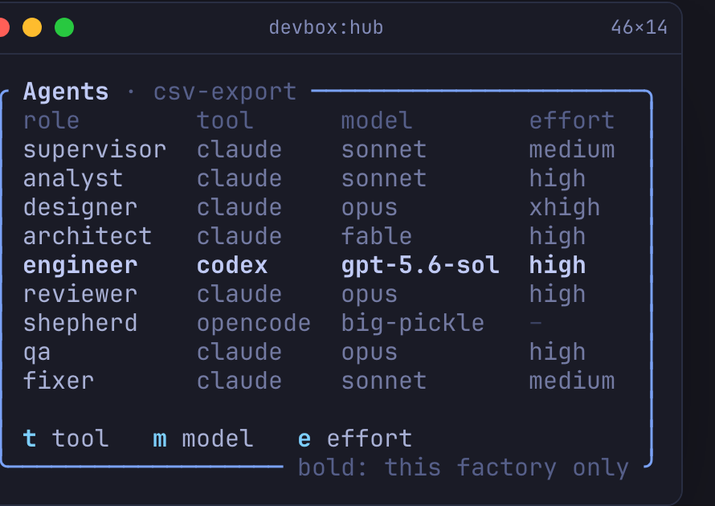

<p align="center">
  
</p>

<p align="center">
  <a href="https://github.com/afonsodelgado/factory/releases/latest"></a>
  <a href="https://github.com/afonsodelgado/factory/actions/workflows/ci.yml"></a>
  <a href="go.mod"></a>
  <a href="LICENSE"></a>
  
  
</p>

<p align="center">
  <b>You're the manager.</b> Give the instructions and your <b>factory</b> takes it to a tested, ready-to-deploy feature, and only stops when it needs you.
</p>

<p align="center">
  <a href="#install">Install</a> ·
  <a href="#how-it-works">How it works</a> ·
  <a href="#use">Use</a> ·
  <a href="#configuration">Configure</a> ·
  <a href="#develop">Develop</a>
</p>

<p align="center">
  
</p>

## What is it

A factory is **an id and a prompt**. Name it, say what you want, and it gets its own worktree, branch and supervisor session. Then it runs a pipeline on its own: requirements, design, plan, code, review, QA and handoff.

Run as many as you like, across every repo you work in. `factory` keeps all of them in one tmux window, so you always know which one needs you.

- **Nothing lands in your repo.** The config lives in `.factory/` and stays out of git.
- **Questions and gates come to you.** Everything else runs unattended.
- **Made for the keyboard.** `j/k` to move, `⏎` to step into a session, `g` to jump to whatever needs you.

## How it works

One agent per stage. The factory waits for you at the gates and runs everything between them on its own.

```
requirements ─ design ─ plan ─ implement ─ review ─ coderabbit ─ qa ─ qa_fixes ─ test_gaps ─ walkthrough ─ handoff
      ◆            ◆       ◆                                                                        ◆            ✓
  you answer   you approve  you approve                                                         you try it   yours to merge
```

The plan is always reviewed and approved before any code is written. At the end you get a stack of draft PRs and a handoff note. **Merging is yours.** The factory never merges, deploys or force-pushes `main`.

Small change? `--pipeline quick` runs requirements, plan, implement, review and handoff. The plan still waits for your approval.

## The right model for each job

<table>
<tr>
<td width="52%" valign="top">

Every role has its own harness, model and effort: **Claude Code**, **Codex** or **OpenCode**. Cheap models for routine stages, the best ones for delicate work.

Agents **hand over through files on disk**: requirements, design, plan and state. It works the same whatever runs on either side.

It runs on **your own subscriptions**, within their limits. No API keys, no API bill.

Each agent ships with defaults. Your config, the repo's config and `--agent` on one factory override them, in that order.

</td>
<td width="48%" valign="top">

</td>
</tr>
</table>

## Install

macOS or Linux, with tmux 3.3 or later, git, [gh](https://cli.github.com) and [Claude Code](https://claude.com/claude-code). `factory doctor` checks the rest.

**1. Download the binary** for your machine: `darwin_arm64`, `darwin_amd64`, `linux_amd64` or `linux_arm64`. The first two lines pick `darwin` or `linux` and `amd64` or `arm64` from `uname`:

```sh
os=$(uname -s | tr '[:upper:]' '[:lower:]')
arch=$(uname -m | sed -e 's/x86_64/amd64/' -e 's/aarch64/arm64/')
gh release download --repo afonsodelgado/factory --pattern "factory_${os}_${arch}" --output ~/.local/bin/factory --clobber
chmod +x ~/.local/bin/factory
```

Or build it with Go 1.26 or later:

```sh
GOPRIVATE=github.com/afonsodelgado/* go install github.com/afonsodelgado/factory/cmd/factory@latest
```

A binary you build has no release version: `factory version` shows `dev`, plus the commit and its date when you build from a checkout with `go build ./cmd/factory`. Built inside a git worktree, it shows the main checkout's commit, because Go reads the commit from the first `.git` directory above the source.

**2. Check the machine and install the skills and hooks.** `doctor` lists what is missing, each with the command that fixes it, and changes nothing. `bootstrap` installs the bundled skills, agents and hooks into your Claude config, backing up any file it replaces.

```sh
factory doctor
factory bootstrap
```

**3. Open the hub.**

```sh
factory
```

Inside tmux, the hub opens in the pane you typed it in, even when that pane is one side of a split; your session, window name and status bar stay as they were. `q` puts your shell back in that pane. Outside tmux, `factory` attaches to a `factory` session instead, and `q` detaches. Either way the factories keep running in the background `factory` session.

`bootstrap` never installs system packages; it prints the `doctor` commands for those. Running it again on an up-to-date machine changes nothing, and it keeps the hooks you already have in `settings.json`. Restart running Claude Code sessions afterwards so they pick up the hooks. `factory install-hooks --remove` takes the hooks out again.

A permission prompt marks its factory "needs you" until the approved tool has run, on the thread that asked: the `PostToolUse` and `PostToolUseFailure` hooks report that, and `doctor` lists them as missing until `bootstrap` or `install-hooks` adds them. A session started before you updated keeps its old hooks until you restart it, and a prompt that was already open when you updated shows as answered.

## Update

```sh
factory version    # what is running, and the latest release
factory --version  # only what is running, with no network call
factory update     # install the latest release, then run its bootstrap
```

`factory version` asks GitHub through `gh`. Without `gh`, or when `gh` is not logged in, it prints only the running version. `factory update` downloads the release binary for your machine next to the running one and replaces it. Then it runs the new binary's `bootstrap`, so the skills, agents and hooks match it. It changes nothing when you already run the latest release, and it refuses when it cannot write to the binary's directory. A running hub keeps the old version: quit it with `q` and run `factory` again.

## Develop

The Go module stays at the repository root: `cmd/`, `internal/` and `bundle/` keep their existing paths. The pnpm workspace holds the website in `apps/web` (`@factory/web`), a static Astro site with React islands, and the phone app in `apps/pwa` (`@factory/pwa`), a Vite and React PWA that the Go binary embeds. `packages/*` is for shared JavaScript packages and does not exist until one has real code.

Go development needs Go 1.26 or later, Make, tmux and jq. JavaScript tooling uses Node 24 (`.nvmrc` pins 24.22.1), pnpm 10.33.0 (`packageManager` in `package.json`) and Turbo 2.11.10. With nvm installed, set up the pinned tools from the repository root:

```sh
nvm install
nvm use
npm install --global pnpm@10.33.0
pnpm install
pnpm --filter @factory/web exec playwright install chromium
```

| Command | Does |
|---|---|
| `make` or `make build` | Build the site and the phone app, copy the app into `bundle/pwa/dist`, then build Go |
| `make test` | Test Go, the site and the phone app |
| `make lint` | Run Go vet, then lint and typecheck both apps |
| `make dev` | Build Go, then start the site at `http://localhost:4321/` |
| `make go-build`, `make go-test`, `make go-lint` | Run `go build ./...`, `go test ./...`, `go vet ./...` |
| `make web-build`, `make web-test`, `make web-lint`, `make web-typecheck`, `make web-dev` | Run the corresponding Turbo task for the site |
| `make pwa-build`, `make pwa-test`, `make pwa-lint`, `make pwa-typecheck`, `make pwa-dev` | Run the corresponding Turbo task for the phone app |
| `make pwa-embed` | Replace `bundle/pwa/dist` with `apps/pwa/dist` and check its build stamp |

With the site present, the whole-repository `make build`, `make lint`, `make test` and `make dev` need Node, pnpm and the Playwright Chromium browser. `make go-build`, `make go-lint` and `make go-test` stay Go-only. The web targets still print a skip message and succeed before looking for pnpm when `apps/web/package.json` is absent. `make dev` builds Go first even with `-j`; it does not start the interactive CLI. Run `go run ./cmd/factory` separately when you intend to open the hub.

The site's scripts are `build` (`astro build` into `apps/web/dist`), `lint` (Prettier), `typecheck` (`astro sync`, then `astro check`), `test` (Playwright against its own `astro preview` on port 4322), `dev` (port 4321) and `preview` (the production build on port 4321). Both servers bind `127.0.0.1` and fail instead of moving to another port when theirs is taken. Every server runs with `--ignore-lock`, so it stays in the foreground even when Astro detects a coding agent, and never hands over to a server that is already running.

`SITE_URL`, an http(s) origin read at build time, sets the absolute URLs in the sitemap, `robots.txt` and the social image tags. It defaults to `http://localhost:4321`: the site runs only locally, has no canonical link and is not deployed. The font subsets, Open Graph image and favicon in `apps/web/public` are committed; `pnpm --filter @factory/web fonts` and `pnpm --filter @factory/web assets` regenerate them, as `apps/web/public/fonts/NOTICE.md` describes. Ordinary builds never do.

Root `pnpm build`, `pnpm test`, `pnpm lint`, `pnpm typecheck` and `pnpm dev` call the guarded web targets. `pnpm turbo run build` is the direct advanced entry point. Turbo caches the site's `dist/` and generated `.astro/` types, and caches lint, typecheck and test results; `test` depends on the same package's `build`, because the browser tests serve `dist`. The build-time `SITE_URL` variable is part of the build, typecheck and test hashes. Development tasks are persistent and uncached. There is no coverage collection, and remote caching is not configured.

The phone app's `dev` serves `127.0.0.1:4323` and its Playwright tests start their own fake gateway on 4324; both fail rather than move. `make pwa-embed` is never cached, so a Turbo cache hit still refreshes the embedded copy. A Go-only build embeds only `bundle/pwa/unavailable.html`: the node answers the app's routes with a "run make build" page. The app's icons in `apps/pwa/public/icons` are committed; `pnpm --filter @factory/pwa icons` regenerates them from the site's favicon.

Repo config autodetection still chooses Go commands because `go.mod` takes precedence over `package.json`. The workspace does not change the repo config.

### CI

Pull requests and pushes to `main` always start CI. Changed paths select the Go matrix on Ubuntu/macOS, the web job on Ubuntu, or both. Go jobs install tmux, jq, Node and pnpm, build and embed the phone app, then run `make go-build`, `make go-lint` and `make go-test`. The web job installs Node from `.nvmrc`, pnpm from `packageManager`, dependencies with `pnpm install --frozen-lockfile` and Playwright's Chromium with its system dependencies, then runs lint, typecheck, test and build for the site and the phone app.

| Changed paths | Validation |
|---|---|
| Root `*.go`, `cmd/**`, `internal/**`, `bundle/**` except `bundle/review/**`, `go.mod`, `go.sum`, release workflow | Go |
| `bundle/review/**` (the review overlay the phone app's browser tests load) | Go and web |
| `apps/pwa/**`, `apps/web/public/fonts/**` (the app's embedded fonts), root pnpm manifests and lockfile, `turbo.json`, `.nvmrc` | Go and web |
| Other `apps/**` (the site in `apps/web`: source, public assets, scripts, tests and config), `packages/**` | Web |
| `Makefile`, `.gitignore`, CI workflow | Go and web |
| Root README, CLAUDE and ordinary docs outside Go-owned directories | Neither workload |

Mixed changes run the union of the matching workloads. Go-owned directories include their data and embedded documentation. Add new build inputs to this table and the inline CI filters together. Pull requests use the changed-files API; main pushes compare against the previous pushed head, including every commit in the push.

Require the final `ci` check in branch protection. It reports success only when change detection succeeds and both workloads succeed or are skipped; failures, cancellations and unexpected results fail it. After adopting this workflow, replace any old matrix requirements with `ci` manually. A started workflow reports this aggregate after path skips or dependency failures, but platform outages, manual workflow cancellation and commit-level CI-skip directives still affect reporting.
### Releases

Pushes to `main` publish a release when they change root Go files, `cmd/`, `internal/`, `bundle/`, `go.mod`, `go.sum`, the release workflow, or what the embedded phone app is built from: `apps/pwa/`, the site's fonts it bundles, root pnpm manifests and lockfile, `turbo.json` and `.nvmrc`. Other site, CI-only and root documentation changes alone do not release; embedded documentation in `bundle/` does. The release installs the frozen JavaScript dependencies, builds and embeds the phone app, and fails when a binary lacks the app's build stamp. The patch version goes up by one from the highest stable semantic-version tag (the first is `v0.1.0`), with a binary for `darwin_arm64`, `darwin_amd64`, `linux_amd64` and `linux_arm64`. An already-tagged main HEAD skips automatic release.

For a minor or major bump, push the tag yourself (`git tag v0.2.0 && git push origin v0.2.0`), and that exact release is published instead. A `v*` tag push releases regardless of changed paths, including tags on site-only commits.


## Add a repo

The factory works in any git repo. In the hub, press `n`, then `+ add a repo…`. Type a path (`~` expands and `tab` completes directories), then press Enter to set it up and open its settings:

- It writes `.factory/config.yml`, with build, lint and test commands detected from `go.mod` or `package.json`.
- It adds `.factory/` and the factory's other paths to `.git/info/exclude`.
- It remembers the main checkout in the hub's list, even when you enter a worktree path.

A non-git path or a setup failure stays in the dialog so you can correct it and retry. Adding a listed repo with a current config opens settings without repeating setup. A listed repo with no current config is set up first.

Press `ctrl+e` on any repo row to edit build, lint and test commands, QA mode, browser start and health, and CodeRabbit. `ctrl+s` saves; `esc` returns without saving. Both return to `n` with that repo selected. Saving preserves comments, existing key order and every other setting. Cleared commands remain as empty strings; terminal mode leaves start and health in the file. Set CodeRabbit on only if it reviews the repo.

Running `factory` inside a repo still sets it up and opens the hub. In this Here mode, `n` shows that repo and the add row; `↑↓` opens the full list to pick another repo. From outside a repo, the dialog lists them all. With no repos, it starts on the path field.

`factory forget <path>` removes a repo from the hub's list and leaves its files alone; a listed repo whose directory is gone drops out the next time the hub starts. Repos listed under `repos` in `config.yml` still show too.

Worktrees have no copy of the repo config, so the skill and its agents read it from the main checkout.

## Use

Every machine runs one node, which owns its factories: their tmux panes, review pages, attention, phone notifications and background work keep going whether or not a hub is open. Start it in the foreground with `factory node run --owner you@example.com`, where the owner is the Tailscale login allowed through Tailscale Serve (or set `node.owner` in `config.yml`, or `FACTORY_NODE_OWNER`). The node listens on an owner-only `node.sock` in the state directory, which the hub and the CLI use, and on `127.0.0.1:7418` (`node.port`), which accepts only requests from Tailscale Serve on this machine that carry the owner's `Tailscale-User-Login`; until `node.hostname` names this machine's Tailscale name, requests through Serve get 421 with a message saying so. A second `factory node run` for the same state directory refuses, and so does a node beside an open hub, `factory host run` or `factory serve` from an older release: stop those first; the node never stops them. `factory open`, the hub and every command that changes a factory refuse with this guidance when no node runs, before doing anything. `factory attention resolve` asks the node whether the item is open and prints the `state.json` edit for the supervisor to make; the node never writes `state.json`.

| Command | Does |
|---|---|
| `factory open` | opens the hub in this pane, or jumps to the hub that is already running |
| `factory open csv-export --prompt "Export contacts as CSV for ops."` | selects the factory `csv-export`, or creates it with that prompt |
| `factory open csv-export Export contacts as CSV for ops.` | the same: the words after the id are the prompt |
| `factory open csv-export` | without a prompt, a new factory's supervisor asks for one |
| `factory open csv-export --repo ~/dev/factory` | in a given repo instead of the one holding the factory or the current directory |
| `factory open csv-export --pipeline quick` | creates it with the `quick` pipeline instead of the default one |
| `factory open csv-export --stages plan,implement,review` | creates it with exactly these stages, plus the ones that always run |
| `factory open csv-export --agent engineer=sonnet:medium` | runs this factory's engineer on Sonnet at medium effort; repeat it for more agents |
| `factory delete csv-export` | deletes the factory and everything local to it, so the id can be used again |
| `factory init ~/dev/new-repo` | non-interactive equivalent for scripts and headless setups; add and configure repos interactively from the hub’s `n` dialog |
| `factory forget ~/dev/old-repo` | stops listing a repo in the hub; its files stay |
| `factory open --remote homelab csv-export --prompt "…"` | creates the factory on the remote `homelab` instead of this machine |

An id is made of lowercase letters, digits and dashes; `factory open "CSV Export"` uses `csv-export`. The command words (`open`, `init`, `doctor`, `bootstrap`, `install-hooks`, `version`, `update`, `hub`, `host`, `node`, `remote`, `view`, `dialog`, `hook`, `help`, `delete`, `forget`, `stage`, `review`) are refused as ids by the `n` dialog and by `factory open`; a `/factory doctor` typed straight into Claude is not guarded. Ids match exactly, and an existing factory is selected, never duplicated. The factory reads an issue tracker only when the prompt asks it to, for example "read Linear issue ENG-1234".

The binary replaces the old `factory` shell function; remove that function from your shell config.

Inside the hub, `?` lists every key. The hub opens on the factory that has waited longest for you. `g` jumps to the next one and puts you in its panel; once you have answered its last item, `⏎` in the panel takes you to the next. `M-0` returns to the factory list from any pane of the hub; `q` quits the UI and leaves every factory running. In the panel, `ctrl+n` and `ctrl+p` move to the next and previous attention item; `[` and `]` type into an answer and move between items only when the item has no form, such as a permission prompt. On a gate, `↓` past the last artifact highlights Approve, and `⏎` there approves with the notes, like `ctrl+a`, which a `C-a` tmux prefix can swallow. `p` pauses the selected factory: Claude stops and its pane closes, while the worktree, branch and state stay, and `w` wakes it again. `a` archives a done, gone or exited factory and can remove its worktree; the factory directory then moves to `.claude/factory-archive/<id>` in the main checkout. It stays listed as archived history (`H` shows it), and a new factory with the same id starts fresh.

`d` deletes the selected factory in any status, and `factory delete <id> [--repo path]` does the same from the shell. Delete closes the factory's pane and its stage panes, stops the processes they started, closes its review tabs, force-removes its worktree (also when the folder was already removed by hand), force-deletes its local branch and every local branch of its stack (from `state.json`, the registry and gh-stack's own record), and removes its factory and QA directories (in the worktree, the main checkout and `.claude/factory-archive`), its `.ready` marker, activity log, drafts, hook records, launch scripts and registry entry. It never deletes `main`, `master` or the remote's default branch, and keeps a branch that another worktree has checked out. A new factory with the same id then gets that id and starts empty. Pushed PRs and remote branches are never touched. Delete always asks first; when the worktree has uncommitted changes or a branch has commits no remote branch has and whose changes are not already on the remote's default branch, it lists them and asks a second time, and `factory delete` refuses that second question when stdin is not a terminal. `--yes` skips only the first question. A delete that fails part way says which step failed and remembers the branches it still has to delete; running it again finishes the job. Deleting a factory that is already gone prints `Nothing to delete` and exits 0.

### Remote servers

A factory can run on an always-on Linux server over SSH, so it keeps going while this machine sleeps. Install the same `factory` release on the server, run `factory bootstrap` there, log Claude Code and `gh` in there, and give the server its own git credentials for your repos. Then:

| Command | Does |
|---|---|
| `factory remote add homelab afonso@homelab.tailnet.ts.net:22 [--identity ~/.ssh/id_ed25519]` | adds the remote `homelab`; without a user, port or `--identity`, ssh uses your ssh config and agent. `R` in the hub does the same from the Remotes popup |
| `factory doctor --remote homelab` | checks ssh, the server's factory release, tools, logins, hooks, git access and forwarding; plain `factory doctor` checks every remote after this machine |
| `factory remote default homelab` | new factories run on `homelab`; `factory remote default local` brings them back here. Existing factories never move |
| `factory open --remote homelab csv-export` / `--local` | picks where a new factory runs; `--git-remote upstream` picks the git remote the server clones from when the repo has no `origin` |
| `factory remote push` | turns on phone push through [ntfy](https://ntfy.sh) with a new private topic to subscribe to; `--server https://ntfy.example.com` uses your own server, `--off` turns it off, `--test` sends a test push from each server |
| `factory delete --remote homelab csv-export` | deletes it on the server, asking the same questions as a local delete |
| `factory stage start --role qa --task t.md --factory csv-export --remote homelab` | runs a stage on a remote factory from outside its panes; `factory review reply` and `factory review threads` take the same `--factory` and `--remote` |
| `factory forget --remote homelab csv-export` | hides it on this machine without touching the server |
| `factory remote list` / `remove homelab` | lists remotes, or stops this machine connecting to one; its factories and push keep running there |

Everything runs over `ssh` with fixed remote commands: `factory host request` with JSON on its standard input for requests, `factory host attach <view>` for `⏎` on a session, and `-L 127.0.0.1:…` forwards for links and for review pages, which reach the server node's owner-only review socket rather than any TCP port. These requests need no listener of their own, nothing forwards your agent, and prompts and paths never reach a shell. The server clones the repo from its git remote under its own state directory and its node starts the factory in its tmux session, so nothing is copied from this machine but the prompt, the repo's `.factory/config.yml` and your `rules.md`. A repo without a network git remote, or with credentials in its remote URL, is refused. If the connection drops after a request was sent, the command says its outcome is unknown; run it again to settle it, and it never creates a second factory. A factory id is checked against this machine and every remote's last known factories, so it stays unique across places. `remotes`, `default_remote` and `push` live in `config.yml`; the commands edit them in place, keep your comments, and write the file privately because the push topic acts as a password.

The hub lists remote factories beside local ones, under a `↔ homelab` group, and every action on them (answer, approve, wake, pause, archive, delete) runs on the server. `⏎` attaches to a remote factory's session over ssh in a proxy pane; leaving or closing it never stops the agent. When a server stops answering for 15 seconds its factories turn grey as `↮ unreachable`, keep their last known state, and actions on them are refused with nothing sent; local factories, including new ones, keep working. `n` asks where a new factory runs, and `R` opens the Remotes popup to add, check and pick remotes and set up phone push. Review pages, the running app and links a server agent opens appear on this laptop through the same stable tunnels, on `127.0.0.1` ports the hub remembers per server. The server needs a running node (`factory node run`); without one, requests from your laptop fail with a message saying so.

Browser QA runs on the machine that holds the factory, in its own headless Chrome; no QA job waits for or runs on a laptop. Finish or interrupt QA started by an older version before you upgrade, then start it again on its node.

### The phone app

The phone app lists this machine's factories, tells you when one needs you, and lets you answer, approve, pause, wake, message a supervisor and review pages with the same comments as the desktop. Remote factories are not shown. It runs at `https://<machine>.<tailnet>.ts.net/` through [Tailscale Serve](https://tailscale.com/docs/reference/tailscale-cli/serve), so the phone needs Tailscale to act, but notifications arrive through the browser's push service on any network. The node serves it whenever it runs; there is no pairing. Every request must carry the node owner's Tailscale login, which Serve adds for a device signed in to Tailscale as that user. Anyone else on the tailnet gets a page that names the owner and shows nothing, and an app that was signed in as the owner clears what it saved. Press `P` in the hub for the Phone popup, or use the commands:

| Command | Does |
|---|---|
| `factory phone status` | prints the app's URL, the loopback port, whether the node runs and how many browsers have notifications on |
| `factory phone test` | asks the running node to send a test notification; "accepted" means the push service took it, not that the phone showed it |
| `factory phone check` | checks Tailscale, HTTPS, the serve mapping, Funnel and the push services, with a fix for each failure |

Once, on this machine: turn on HTTPS Certificates for the tailnet, put this machine's full Tailscale name in `config.yml` as `node.hostname` (for example `devbox.tail1234.ts.net`), then run `tailscale serve --bg --https=443 http://127.0.0.1:7418`. Never use Funnel. On iPhone, add the app to the Home Screen (iOS 16.4 or later) before turning on notifications. Each browser that turns notifications on is kept by its push endpoint; opening the app again re-registers the same subscription without turning it off.

Upgrading from a release with pairing: the first `factory node run` moves `phone.hostname` and `phone.port` to `node.hostname` and `node.port`, keeps the push keys, every subscription and the queued notifications, then deletes the pairing codes and device hashes. Paired phones keep getting notifications and open the app again over the tailnet as the owner; operations a phone sent before the upgrade stay readable until they settle.

### Reviewing designs and plans

Designs and plans are HTML pages in the factory directory, listed in the panel's Artifacts tab and on its gates. `o` opens one in your browser on the node's review page at `https://<machine>.<tailnet>.ts.net/r/…`, the same page the phone app opens. The node never opens a browser itself. There:

- `C`, then click anything, leaves a comment on that element: a fix, a change or a question. *Comment on the whole page* in the comments list covers the rest.
- Comments are saved as you write them. **Send** delivers the ones not sent yet to the agent that owns the page: the designer or the architect, in its own pane.
- The agent changes the page, which reloads by itself, and answers each thread. Reply on a thread to keep the conversation going; your reply goes out with the next Send.
- **Approve** appears while the page's gate is open and sends the same approval as the panel.

In a web repo, the design can instead be a working prototype built from the app's real components and stylesheet:

1. Set `design.prototype` in the repo config (see "Repo config").
2. The designer writes each variant into that git-ignored directory.
3. The hub runs the app's dev server; open the variants' URLs in your own browser. Until the node publishes dev servers on the tailnet, ask for changes through the design gate in the panel or the phone.

The panel shows each page's open threads. `factory review threads` lists them in a terminal. `factory review open <url>` prints the URL of any page, such as your app on its dev server, for you to open; a laptop hub connected over ssh opens it through its tunnel.

### Walking through the finished app

In repos with browser QA, the `walkthrough` stage comes after QA, just before the handoff:

1. QA writes a script that starts this worktree's stack on free ports, signed in as a test user.
2. The hub runs that script in a window of its own, so you can see its logs.
3. When the stack answers, open the app's URL from the walkthrough gate in your own browser.

Click through the change and send anything you want different as changes on the walkthrough gate. Each goes to the fixer, which changes the code on the QA-fixes layer, and the dev server reloads it in the same tab. Approve in the panel or on the phone when it is right. The stack stops when the factory is done.

## Configuration

`~/.config/factory/config.yml` (or `$FACTORY_CONFIG_DIR/config.yml`):

```yaml
repos: []  # optional; factory lists the repos you run it in by itself
hub:
  session: factory
  return_key: M-0
stalled_after: 20m
alerts:
  bell: false
  desktop: false
icons: nerd
review:
  chrome: ""
```

`alerts.desktop` sends a desktop notification when a factory needs you: through `osascript` on macOS and `notify-send` on Linux. The older `alerts.macos` key still works. `hub.session` names the background session that holds the factories' panes, and the hub's own window outside tmux. `return_key: prefix` binds `prefix f` instead of `M-0`; `icons: unicode` draws plain Unicode instead of Nerd Font icons. The node serves the factories' design and plan pages to the phone app and the hub through its own listener and to local tools and ssh tunnels through the owner-only `review.sock` in the state directory; it never opens a browser window. `review.chrome` names the Chrome binary for headless browser QA when it is not in the usual place. Older `review.port` and `review.browser` keys are ignored. Every other value above is the default.

State (registry, hook files, drafts, the hub socket) lives in `~/.local/state/factory` or `$FACTORY_STATE_DIR`.

### Repo config

Add and configure repos from the hub: press `n`, then `+ add a repo…`, or `ctrl+e` on a listed repo. `ctrl+s` saves only the form's keys; `esc` cancels. A malformed file is shown as an error and cannot be overwritten. If the file changes while settings are open, reopen the form before saving.

Each repo's main checkout has its own config in `.factory/config.yml`. It is never committed: `.factory/` is listed in the repo's `.git/info/exclude`. It holds the repo's commands, QA, design and CodeRabbit settings, and it can override these global keys for that repo: `pipelines`, `default_pipeline`, `agents`, `supervisor`, `stalled_after` and `codex.writable_dirs`.

```yaml
commands: {build: make build, lint: make lint, test: make test}
qa: {mode: terminal}
coderabbit: false
supervisor: {effort: medium}
stalled_after: 45m
```

`agents` and `supervisor` override one field at a time, `pipelines` override by name, and `codex.writable_dirs` adds to the global list. A web repo can have the designer build prototypes from the app's real components:

```yaml
design:
  source: web
  files: [DESIGN.md]
  prototype:
    dir: apps/web/prototypes   # git-ignored, inside the web app's dev server root
    path: /prototypes          # where that dev server serves it
    css: apps/web/src/index.css
```

Browser QA runs on Mac and Linux nodes in a headless Chrome that the node starts for one QA stage at a time, with a new temporary profile, and drives only through Chrome DevTools MCP, pinned to `chrome-devtools-mcp@1.13.0` and run with usage statistics and CrUX lookups off. Before the QA pane starts, the node runs `qa.start`, waits for `qa.health` to answer `qa.health_status` (default 200) within `qa.startup_timeout` (default `2m`), then runs `qa.seed` and `qa.sign_in`, sets the printed cookies in that profile and writes an MCP config for that stage alone; it never edits your global Claude config. Seed prepares an isolated test environment and must be repeatable; sign-in prints the session cookies as a JSON list of `{name, value}`. Write `none` for an app without fixtures or sign-in: QA refuses to start, by name and before any browser launches, while either key is missing. Nobody can watch or type into that browser, so captchas and interactive 2FA are not supported; a failing step ends the stage with a named failure. The browser and its profile close when the QA result arrives, when the factory finishes and when the node stops. `factory doctor` checks `npx` and Chrome for repos with browser QA.

```yaml
qa: {mode: browser, web_port: 3001, start: npm run dev, health: http://localhost:3000/api/health, seed: npm run db:seed:test, sign_in: none}
```

`repos`, `hub`, `alerts`, `icons`, `tmux` and `review` belong to the machine; `factory doctor` reports them when a repo config sets them. A repo set up before `.factory/` has `.claude/factory.yml`. The factory still reads it. In the hub, press `n`, then `+ add a repo…`, or use `ctrl+e` on its row: setup copies it to `.factory/config.yml` before opening settings, leaving the old file for factories already running there.

## Pipelines

A pipeline is the list of stages a factory runs. Two are built in, so they work with no config:

```yaml
pipelines:
  full:  [requirements, design, plan, implement, review, coderabbit, qa, qa_fixes, test_gaps, walkthrough, handoff]
  quick: [requirements, plan, implement, review, handoff]
default_pipeline: full
```

Put `pipelines` and `default_pipeline` in `config.yml` to add presets or replace a built-in by name. A repo's `.factory/config.yml` can do the same, and it wins over `config.yml`. The keys are the stage keys above. `requirements` and `handoff` always run, even when a preset leaves them out, `qa_fixes` and `test_gaps` run only with `qa`, and `walkthrough` runs only in repos with browser QA (`qa.mode: browser`). The name `custom` is reserved for a factory's own list. An unknown stage key is a config error: `factory doctor` reports it and `factory open` refuses to start, naming the file and the key.

Pick the stages when you create a factory: the `n` dialog has a step of its own for them, "Stages & agents", between the id and the prompt. It starts at `default_pipeline`. `tab` loads the next preset, `↑↓` move through the stages, `space` checks or unchecks the selected one, and `⏎` goes on to the prompt. When the checked stages match no preset, the factory runs a `custom` pipeline. From the shell, use `factory open <id> --pipeline <name>` for a preset, or `--stages a,b,c` for an exact list; give one or the other, not both. An unknown name is refused with the list of available ones. The factory list shows the pipeline next to the stage when it is not the default.

A pipeline only removes stages. The gates stay: `quick` still shows you the plan and waits for your approval before any code is written. `coderabbit: false` in the repo config still removes CodeRabbit from whichever pipeline you pick, and the design stage still runs only when the change has a user interface. Skipped stages show as `–` in the stage track.

## Agent models

Each stage runs one agent, and each agent has a default model and effort in its `bundle/agents/factory-<role>.md` file. The roles are `analyst`, `designer`, `architect`, `engineer`, `reviewer`, `shepherd`, `qa` and `fixer`; the fixer runs `qa_fixes`, `test_gaps` and `walkthrough`. To spend less, set them in `config.yml`, in a repo's `.factory/config.yml`, or for one factory:

```yaml
agents:
  analyst:  {model: sonnet}
  engineer: {model: sonnet, effort: medium}
  reviewer: {effort: medium}
  shepherd: {model: sonnet, effort: low}
```

Each layer overrides the one before it, one field at a time: the agent file, then `config.yml`, then the repo config, then the factory. Models are `haiku`, `sonnet`, `opus` and `fable`. Efforts are `low`, `medium`, `high`, `xhigh` and `max`. `factory doctor` reports an unknown role, model or effort, naming the file and the key.

For one factory, press `m` (model) or `e` (effort) on a stage's row in the dialog's "Stages & agents" step, or pass `--agent role=model:effort` to `factory open`. Either side can be empty, as in `--agent reviewer=:low`. A value set for this factory alone is shown in bold. The supervisor writes the result to `state.json`, so a resumed factory keeps its models. It passes them to the Agent tool on every spawn, and the files in `~/.claude/agents` stay as the bundle installed them.

## Codex and OpenCode

Every role, and the supervisor itself, can run on `claude`, `codex` or `opencode`. Set a `tool` with the model and effort:

```yaml
supervisor: {tool: claude}
agents:
  engineer: {tool: codex, model: gpt-6.1-sol, effort: high}
  reviewer: {tool: opencode, model: big-pickle}
codex:
  writable_dirs: [~/.cargo]   # extra dirs a Codex stage may write, beside the repo's git dir, the worktree's own git dir and the Go and npm caches
```

In the dialog's "Stages & agents" step, `t` cycles a row's tool, and the top row is the supervisor; `factory open` takes `--agent engineer=codex/gpt-6.1-sol:high` and `--supervisor codex/gpt-6.1-sol:high`. A layer that changes the tool drops the model and effort of the tool before it. Switching back to `claude` without a model or effort gives the role its agent file's defaults, such as `opus` at `xhigh` for the engineer; switching to Codex or OpenCode without them uses that tool's default when the stage starts. No API key is used anywhere: Codex offers the models your ChatGPT login lists (an API-key login is refused), OpenCode offers only its free models, and `qa` always runs on `claude`, because it drives Chrome. `factory doctor`, `factory open` and the dialog check a Codex model and effort against `~/.codex/models_cache.json`, and an OpenCode model and variant against the cached list of free models; when a list cannot be read yet, doctor warns that it can't check them.

A role on another tool runs in its own pane, and while it works the hub splits the session view and shows it beside the supervisor; the split closes when the stage writes its result. The supervisor starts and follows up with these roles through `factory stage`. Codex runs each stage unattended, in a sandbox that may write the worktree, the repo's git dir and the caches above, and reach the network.

With a Claude supervisor, `claude` roles are still subagents, except the iterating designer and the architect, which run in panes of their own so your comments reach them. OpenCode has no `/factory` command: it reads the factory skill from `~/.claude/skills`, so the app sends it `Use the factory skill for: /factory …` instead.

Your coding rules go in `~/.config/factory/rules.md` (or `$FACTORY_CONFIG_DIR/rules.md`). Every stage agent receives them, on every tool, before the repo's own `AGENTS.md` and `CLAUDE.md`.

Before the first factory on Codex, run `factory bootstrap`, then `codex` once in each repo and choose "Trust and continue", or Codex stops at that prompt. Factory starts Codex with `--dangerously-bypass-hook-trust`, so Codex never asks to trust hooks in a factory, and every enabled hook runs there, not only factory's. `factory doctor` checks the Codex login, that trust, and that a sandboxed commit, push and `gh` work. It runs the Codex and OpenCode checks whenever the config, a repo config or a factory that is not archived uses that tool, so a pick made only in the dialog is checked too.
