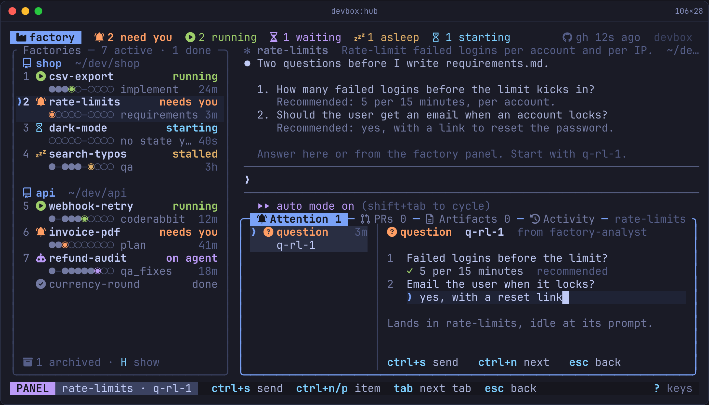

<p align="center">
  
</p>

<p align="center">
  <a href="https://github.com/afonsodelgado/factory/releases/latest"></a>
  <a href="https://github.com/afonsodelgado/factory/actions/workflows/ci.yml"></a>
  <a href="go.mod"></a>
  <a href="LICENSE"></a>
  
  
</p>

<p align="center">
  <b>You're the manager.</b> Give the instructions and your <b>factory</b> takes it to a tested, ready-to-deploy feature, and only stops when it needs you.
</p>

<p align="center">
  <a href="#install">Install</a> ·
  <a href="#how-it-works">How it works</a> ·
  <a href="#use">Use</a> ·
  <a href="#configuration">Configure</a> ·
  <a href="#develop">Develop</a>
</p>

<p align="center">
  
</p>

## What is it

A factory is **an id and a prompt**. Name it, say what you want, and it gets its own worktree, branch and supervisor session. Then it runs a pipeline on its own: requirements, design, plan, code, review, QA and handoff.

Run as many as you like, across every repo you work in. `factory` keeps all of them in one tmux window, so you always know which one needs you.

- **Nothing lands in your repo.** The config lives in `.factory/` and stays out of git.
- **Questions and gates come to you.** Everything else runs unattended.
- **Made for the keyboard.** `j/k` to move, `⏎` to step into a session, `g` to jump to whatever needs you.

## How it works

One agent per stage. The factory waits for you at the gates and runs everything between them on its own.

```
requirements ─ design ─ plan ─ implement ─ review ─ coderabbit ─ qa ─ qa_fixes ─ test_gaps ─ handoff
      ◆            ◆       ◆                                                                    ✓
  you answer   you approve  you approve                                                  yours to merge
```

The plan is always published and approved before any code is written. At the end you get a stack of draft PRs and a handoff note. **Merging is yours.** The factory never merges, deploys or force-pushes `main`.

Small change? `--pipeline quick` runs requirements, plan, implement, review and handoff. The plan still waits for your approval.

## The right model for each job

<table>
<tr>
<td width="52%" valign="top">

Every role has its own harness, model and effort: **Claude Code**, **Codex** or **OpenCode**. Cheap models for routine stages, the best ones for delicate work.

Agents **hand over through files on disk**: requirements, design, plan and state. It works the same whatever runs on either side.

It runs on **your own subscriptions**, within their limits. No API keys, no API bill.

Each agent ships with defaults. Your config, the repo's config and `--agent` on one factory override them, in that order.

</td>
<td width="48%" valign="top">

</td>
</tr>
</table>

## Install

macOS or Linux, with tmux 3.3 or later, git, [gh](https://cli.github.com) and [Claude Code](https://claude.com/claude-code). `factory doctor` checks the rest.

**1. Download the binary** for your machine: `darwin_arm64`, `darwin_amd64`, `linux_amd64` or `linux_arm64`.

```sh
gh release download --repo afonsodelgado/factory --pattern 'factory_darwin_arm64' --output ~/.local/bin/factory
chmod +x ~/.local/bin/factory
```

Or build it with Go 1.26 or later:

```sh
GOPRIVATE=github.com/afonsodelgado/* go install github.com/afonsodelgado/factory/cmd/factory@latest
```

A binary you build has no release version: `factory version` shows `dev`, plus the commit and its date when you build from a checkout with `go build ./cmd/factory`. Built inside a git worktree, it shows the main checkout's commit, because Go reads the commit from the first `.git` directory above the source.

**2. Check the machine and install the skills and hooks.** `doctor` lists what is missing, each with the command that fixes it, and changes nothing. `bootstrap` installs the bundled skills, agents and hooks into your Claude config, backing up any file it replaces.

```sh
factory doctor
factory bootstrap
```

**3. Open the hub.**

```sh
factory
```

`bootstrap` never installs system packages; it prints the `doctor` commands for those. Running it again on an up-to-date machine changes nothing, and it keeps the hooks you already have in `settings.json`. Restart running Claude Code sessions afterwards so they pick up the hooks. `factory install-hooks --remove` takes the hooks out again.

A permission prompt marks its factory "needs you" until the approved tool has run, on the thread that asked: the `PostToolUse` and `PostToolUseFailure` hooks report that, and `doctor` lists them as missing until `bootstrap` or `install-hooks` adds them. A session started before you updated keeps its old hooks until you restart it, and a prompt that was already open when you updated shows as answered.

## Update

```sh
factory version    # what is running, and the latest release
factory --version  # only what is running, with no network call
factory update     # install the latest release, then run its bootstrap
```

`factory version` asks GitHub through `gh`. Without `gh`, or when `gh` is not logged in, it prints only the running version. `factory update` downloads the release binary for your machine next to the running one and replaces it. Then it runs the new binary's `bootstrap`, so the skills, agents and hooks match it. It changes nothing when you already run the latest release, and it refuses when it cannot write to the binary's directory. A running hub keeps the old version: quit it with `q` and run `factory` again.

## Develop

The Go module stays at the repository root: `cmd/`, `internal/` and `bundle/` keep their existing paths. The pnpm workspace holds the website in `apps/web` (`@factory/web`): a static Astro site with React islands. `packages/*` is for shared JavaScript packages and does not exist until one has real code.

Go development needs Go 1.26 or later, Make, tmux and jq. JavaScript tooling uses Node 24 (`.nvmrc` pins 24.22.1), pnpm 10.33.0 (`packageManager` in `package.json`) and Turbo 2.11.10. With nvm installed, set up the pinned tools from the repository root:

```sh
nvm install
nvm use
npm install --global pnpm@10.33.0
pnpm install
pnpm --filter @factory/web exec playwright install chromium
```

| Command | Does |
|---|---|
| `make` or `make build` | Build Go and the web packages |
| `make test` | Test Go and the web packages |
| `make lint` | Run Go vet, web lint and web typecheck |
| `make dev` | Build Go, then start the site at `http://localhost:4321/` |
| `make go-build`, `make go-test`, `make go-lint` | Run `go build ./...`, `go test ./...`, `go vet ./...` |
| `make web-build`, `make web-test`, `make web-lint`, `make web-typecheck`, `make web-dev` | Run the corresponding Turbo task |

With the site present, the whole-repository `make build`, `make lint`, `make test` and `make dev` need Node, pnpm and the Playwright Chromium browser. `make go-build`, `make go-lint` and `make go-test` stay Go-only. The web targets still print a skip message and succeed before looking for pnpm when `apps/web/package.json` is absent. `make dev` builds Go first even with `-j`; it does not start the interactive CLI. Run `go run ./cmd/factory` separately when you intend to open the hub.

The site's scripts are `build` (`astro build` into `apps/web/dist`), `lint` (Prettier), `typecheck` (`astro sync`, then `astro check`), `test` (Playwright against its own `astro preview` on port 4322), `dev` (port 4321) and `preview` (the production build on port 4321). Both servers bind `127.0.0.1` and fail instead of moving to another port when theirs is taken. Every server runs with `--ignore-lock`, so it stays in the foreground even when Astro detects a coding agent, and never hands over to a server that is already running.

`SITE_URL`, an http(s) origin read at build time, sets the absolute URLs in the sitemap, `robots.txt` and the social image tags. It defaults to `http://localhost:4321`: the site runs only locally, has no canonical link and is not deployed. The font subsets, Open Graph image and favicon in `apps/web/public` are committed; `pnpm --filter @factory/web fonts` and `pnpm --filter @factory/web assets` regenerate them, as `apps/web/public/fonts/NOTICE.md` describes. Ordinary builds never do.

Root `pnpm build`, `pnpm test`, `pnpm lint`, `pnpm typecheck` and `pnpm dev` call the guarded web targets. `pnpm turbo run build` is the direct advanced entry point. Turbo caches the site's `dist/` and generated `.astro/` types, and caches lint, typecheck and test results; `test` depends on the same package's `build`, because the browser tests serve `dist`. The build-time `SITE_URL` variable is part of the build, typecheck and test hashes. Development tasks are persistent and uncached. There is no coverage collection, and remote caching is not configured.

Repo config autodetection still chooses Go commands because `go.mod` takes precedence over `package.json`. The workspace does not change the repo config.

### CI

Pull requests and pushes to `main` always start CI. Changed paths select the Go matrix on Ubuntu/macOS, the web job on Ubuntu, or both. Go jobs install tmux and jq and run `make go-build`, `make go-lint` and `make go-test` without Node. The web job installs Node from `.nvmrc`, pnpm from `packageManager`, dependencies with `pnpm install --frozen-lockfile` and Playwright's Chromium with its system dependencies, then runs web lint, typecheck, test and build.

| Changed paths | Validation |
|---|---|
| Root `*.go`, `cmd/**`, `internal/**`, `bundle/**`, `go.mod`, `go.sum`, release workflow | Go |
| `apps/**` (the site in `apps/web`: source, public assets and fonts, scripts, tests and config), `packages/**`, root pnpm manifests and lockfile, `turbo.json`, `.nvmrc` | Web |
| `Makefile`, `.gitignore`, CI workflow | Go and web |
| Root README, CLAUDE and ordinary docs outside Go-owned directories | Neither workload |

Mixed changes run the union of the matching workloads. Go-owned directories include their data and embedded documentation. Add new build inputs to this table and the inline CI filters together. Pull requests use the changed-files API; main pushes compare against the previous pushed head, including every commit in the push.

Require the final `ci` check in branch protection. It reports success only when change detection succeeds and both workloads succeed or are skipped; failures, cancellations and unexpected results fail it. After adopting this workflow, replace any old matrix requirements with `ci` manually. A started workflow reports this aggregate after path skips or dependency failures, but platform outages, manual workflow cancellation and commit-level CI-skip directives still affect reporting.
### Releases

Pushes to `main` publish a release when they change root Go files, `cmd/`, `internal/`, `bundle/`, `go.mod`, `go.sum` or the release workflow. Site, JavaScript tooling, CI-only and root documentation changes alone do not release; embedded documentation in `bundle/` does. The patch version goes up by one from the highest stable semantic-version tag (the first is `v0.1.0`), with a binary for `darwin_arm64`, `darwin_amd64`, `linux_amd64` and `linux_arm64`. An already-tagged main HEAD skips automatic release.

For a minor or major bump, push the tag yourself (`git tag v0.2.0 && git push origin v0.2.0`), and that exact release is published instead. A `v*` tag push releases regardless of changed paths, including tags on site-only commits.


## Add a repo

The factory works in any git repo. Run `factory` anywhere inside it, or inside one of its worktrees. The first time, it sets the repo up before it opens the hub:

- It writes the repo config, `.factory/config.yml`, from the bundled template, with build, lint and test commands detected from `go.mod` or `package.json`.
- It adds `.factory/` and the factory's other files to the repo's `.git/info/exclude`, so nothing is committed to the repo.
- It adds the repo to the hub's list, in `repos.json` in the state directory. A hub that is already running shows the repo at once.

The hub then says what it did. Edit the repo config to match the repo; set `coderabbit: true` only if CodeRabbit reviews the repo. Later runs change nothing.

Inside the hub, `n` creates the factory in the repo you ran `factory` from, without a list of repos to choose from. `↑↓` still picks another repo. From outside any repo, the dialog lists them all.

`factory init [path]` does the same setup without opening the hub. `factory forget <path>` removes a repo from the hub's list and leaves its files alone; a listed repo whose directory is gone drops out the next time the hub starts. Repos listed under `repos` in `config.yml` still show too.

Worktrees have no copy of the repo config, so the skill and its agents read it from the main checkout.

## Use

| Command | Does |
|---|---|
| `factory open` | attaches to the hub, starting it if needed |
| `factory open csv-export --prompt "Export contacts as CSV for ops."` | selects the factory `csv-export`, or creates it with that prompt |
| `factory open csv-export Export contacts as CSV for ops.` | the same: the words after the id are the prompt |
| `factory open csv-export` | without a prompt, a new factory's supervisor asks for one |
| `factory open csv-export --repo ~/dev/factory` | in a given repo instead of the one holding the factory or the current directory |
| `factory open csv-export --pipeline quick` | creates it with the `quick` pipeline instead of the default one |
| `factory open csv-export --stages plan,implement,review` | creates it with exactly these stages, plus the ones that always run |
| `factory open csv-export --agent engineer=sonnet:medium` | runs this factory's engineer on Sonnet at medium effort; repeat it for more agents |
| `factory delete csv-export` | deletes the factory and everything local to it, so the id can be used again |
| `factory forget ~/dev/old-repo` | stops listing a repo in the hub; its files stay |

An id is made of lowercase letters, digits and dashes; `factory open "CSV Export"` uses `csv-export`. The command words (`open`, `init`, `doctor`, `bootstrap`, `install-hooks`, `version`, `update`, `hub`, `view`, `dialog`, `hook`, `help`, `delete`, `forget`) are refused as ids by the `n` dialog and by `factory open`; a `/factory doctor` typed straight into Claude is not guarded. Ids match exactly, and an existing factory is selected, never duplicated. The factory reads an issue tracker only when the prompt asks it to, for example "read Linear issue ENG-1234".

The binary replaces the old `factory` shell function; remove that function from your shell config.

Inside the hub, `?` lists every key. `M-0` returns to the factory list from any pane of the hub; `q` quits the UI and leaves every factory running. In the panel, `ctrl+n` and `ctrl+p` move to the next and previous attention item; `[` and `]` type into an answer and move between items only when the item has no form, such as a permission prompt. On a gate, `↓` past the last artifact highlights Approve, and `⏎` there approves with the notes, like `ctrl+a`, which a `C-a` tmux prefix can swallow. `p` pauses the selected factory: Claude stops and its pane closes, while the worktree, branch and state stay, and `w` wakes it again. `a` archives a done, gone or exited factory and can remove its worktree; the factory directory then moves to `.claude/factory-archive/<id>` in the main checkout. It stays listed as archived history (`H` shows it), and a new factory with the same id starts fresh.

`d` deletes the selected factory in any status, and `factory delete <id> [--repo path]` does the same from the shell. Delete closes the factory's pane, force-removes its worktree, force-deletes its local branch and every local branch of its PR stack, and removes its factory and QA directories (in the worktree, the main checkout and `.claude/factory-archive`), its `.ready` marker, activity log, drafts and registry entry. A new factory with the same id then gets that id and starts empty. Pushed PRs and remote branches are never touched. Delete always asks first; when the worktree has uncommitted changes or a branch has commits no remote branch has, it lists them and asks a second time, and `factory delete` refuses that second question when stdin is not a terminal. `--yes` skips only the first question. A delete that fails part way says which step failed; running it again finishes the job.

## Configuration

`~/.config/factory/config.yml` (or `$FACTORY_CONFIG_DIR/config.yml`):

```yaml
repos: []  # optional; factory lists the repos you run it in by itself
hub:
  session: factory
  return_key: M-0
stalled_after: 20m
alerts:
  bell: false
  desktop: false
icons: nerd
claude:
  remote_control: true
```

`alerts.desktop` sends a desktop notification when a factory needs you: through `osascript` on macOS and `notify-send` on Linux. The older `alerts.macos` key still works. `return_key: prefix` binds `prefix f` instead of `M-0`; `icons: unicode` draws plain Unicode instead of Nerd Font icons. Every other value above is the default.

State (registry, hook files, drafts, the hub socket) lives in `~/.local/state/factory` or `$FACTORY_STATE_DIR`.

### Repo config

Each repo's main checkout has its own config in `.factory/config.yml`. It is never committed: `.factory/` is listed in the repo's `.git/info/exclude`. It holds the repo's commands, QA, design and CodeRabbit settings, and it can override these global keys for that repo: `pipelines`, `default_pipeline`, `agents`, `supervisor`, `stalled_after`, `claude.remote_control` and `codex.writable_dirs`.

```yaml
commands: {build: make build, lint: make lint, test: make test}
qa: {mode: terminal}
coderabbit: false
supervisor: {effort: medium}
stalled_after: 45m
```

`agents` and `supervisor` override one field at a time, `pipelines` override by name, and `codex.writable_dirs` adds to the global list. `repos`, `hub`, `alerts`, `icons` and `tmux` belong to the machine; `factory doctor` reports them when a repo config sets them. A repo set up before `.factory/` has `.claude/factory.yml`. The factory still reads it, and `factory init` copies it to `.factory/config.yml` and leaves the old file for factories already running there.

## Pipelines

A pipeline is the list of stages a factory runs. Two are built in, so they work with no config:

```yaml
pipelines:
  full:  [requirements, design, plan, implement, review, coderabbit, qa, qa_fixes, test_gaps, handoff]
  quick: [requirements, plan, implement, review, handoff]
default_pipeline: full
```

Put `pipelines` and `default_pipeline` in `config.yml` to add presets or replace a built-in by name. A repo's `.factory/config.yml` can do the same, and it wins over `config.yml`. The keys are the stage keys above. `requirements` and `handoff` always run, even when a preset leaves them out, and `qa_fixes` and `test_gaps` run only with `qa`. The name `custom` is reserved for a factory's own list. An unknown stage key is a config error: `factory doctor` reports it and `factory open` refuses to start, naming the file and the key.

Pick the stages when you create a factory: the `n` dialog has a step of its own for them, "Stages & agents", between the id and the prompt. It starts at `default_pipeline`. `tab` loads the next preset, `↑↓` move through the stages, `space` checks or unchecks the selected one, and `⏎` goes on to the prompt. When the checked stages match no preset, the factory runs a `custom` pipeline. From the shell, use `factory open <id> --pipeline <name>` for a preset, or `--stages a,b,c` for an exact list; give one or the other, not both. An unknown name is refused with the list of available ones. The factory list shows the pipeline next to the stage when it is not the default.

A pipeline only removes stages. The gates stay: `quick` still publishes the plan and waits for your approval before any code is written. `coderabbit: false` in the repo config still removes CodeRabbit from whichever pipeline you pick, and the design stage still runs only when the change has a user interface. Skipped stages show as `–` in the stage track.

## Agent models

Each stage runs one agent, and each agent has a default model and effort in its `bundle/agents/factory-<role>.md` file. The roles are `analyst`, `designer`, `architect`, `engineer`, `reviewer`, `shepherd`, `qa` and `fixer`; the fixer runs both `qa_fixes` and `test_gaps`. To spend less, set them in `config.yml`, in a repo's `.factory/config.yml`, or for one factory:

```yaml
agents:
  analyst:  {model: sonnet}
  engineer: {model: sonnet, effort: medium}
  reviewer: {effort: medium}
  shepherd: {model: sonnet, effort: low}
```

Each layer overrides the one before it, one field at a time: the agent file, then `config.yml`, then the repo config, then the factory. Models are `haiku`, `sonnet`, `opus` and `fable`. Efforts are `low`, `medium`, `high`, `xhigh` and `max`. `factory doctor` reports an unknown role, model or effort, naming the file and the key.

For one factory, press `m` (model) or `e` (effort) on a stage's row in the dialog's "Stages & agents" step, or pass `--agent role=model:effort` to `factory open`. Either side can be empty, as in `--agent reviewer=:low`. A value set for this factory alone is shown in bold. The supervisor writes the result to `state.json`, so a resumed factory keeps its models. It passes them to the Agent tool on every spawn, and the files in `~/.claude/agents` stay as the bundle installed them.

## Codex and OpenCode

Every role, and the supervisor itself, can run on `claude`, `codex` or `opencode`. Set a `tool` with the model and effort:

```yaml
supervisor: {tool: claude}
agents:
  engineer: {tool: codex, model: gpt-5.6-sol, effort: high}
  reviewer: {tool: opencode, model: big-pickle}
codex:
  writable_dirs: [~/.cargo]   # extra dirs a Codex stage may write, beside the repo's git dir, the worktree's own git dir and the Go and npm caches
```

In the dialog's "Stages & agents" step, `t` cycles a row's tool, and the top row is the supervisor; `factory open` takes `--agent engineer=codex/gpt-5.6-sol:high` and `--supervisor codex/gpt-5.6-sol:high`. A layer that changes the tool drops the model and effort of the tool before it. Switching back to `claude` without a model or effort gives the role its agent file's defaults, such as `opus` at `xhigh` for the engineer; switching to Codex or OpenCode without them uses that tool's default when the stage starts. No API key is used anywhere: Codex offers the models your ChatGPT login lists (an API-key login is refused), OpenCode offers only its free models, and `qa` always runs on `claude`, because it drives Chrome. `factory doctor`, `factory open` and the dialog check a Codex model and effort against `~/.codex/models_cache.json`, and an OpenCode model and variant against the cached list of free models; when a list cannot be read yet, doctor warns that it can't check them.

A role on another tool runs in its own pane, and while it works the hub splits the session view and shows it beside the supervisor; the split closes when the stage writes its result. The supervisor starts and follows up with these roles through `factory stage`. Codex runs each stage unattended, in a sandbox that may write the worktree, the repo's git dir and the caches above, and reach the network.

With a Claude supervisor nothing else changes: `claude` roles are still subagents, and designs and plans are still artifacts you comment on. With a Codex or OpenCode supervisor, designs and plans stay as HTML files in the factory directory, listed in the panel's Artifacts tab, and you give feedback in the session or from the panel. OpenCode has no `/factory` command: it reads the factory skill from `~/.claude/skills`, so the app sends it `Use the factory skill for: /factory …` instead.

Your coding rules go in `~/.config/factory/rules.md` (or `$FACTORY_CONFIG_DIR/rules.md`). Every stage agent receives them, on every tool, before the repo's own `AGENTS.md` and `CLAUDE.md`.

Before the first factory on Codex, run `factory bootstrap`, then `codex` once in each repo: choose "Trust and continue" and "Trust all" for the factory hooks, or Codex stops at those prompts. `factory doctor` checks the Codex login, that trust, and that a sandboxed commit, push and `gh` work. It runs the Codex and OpenCode checks whenever the config, a repo config or a factory that is not archived uses that tool, so a pick made only in the dialog is checked too.
