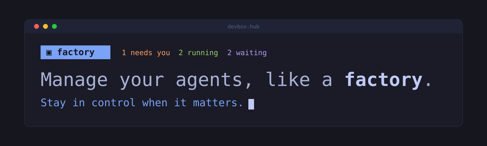

<p align="center">
  
</p>

<p align="center">
  <a href="https://github.com/afonsodelgado/factory/releases/latest"></a>
  <a href="https://github.com/afonsodelgado/factory/actions/workflows/ci.yml"></a>
  <a href="go.mod"></a>
  <a href="LICENSE"></a>
  
  
</p>

<p align="center">
  <b>You're the manager.</b> Give the instructions and your <b>factory</b> takes it to a tested, ready-to-deploy feature, and only stops when it needs you.
</p>

<p align="center">
  <a href="#how-it-works">How it works</a> ·
  <a href="#1-set-up-your-machine">Your machine</a> ·
  <a href="#2-add-a-remote-server">Remote servers</a> ·
  <a href="#3-set-up-your-phone">Phone</a> ·
  <a href="docs/reference.md">Reference</a>
</p>

<p align="center">
  
</p>

## How it works

A **factory** is an id and a prompt: "csv-export: let ops export contacts as CSV". It gets its own branch and worktree, and a team of agents takes it from requirements to tested, open pull requests. It stops only when it needs you.

```
requirements → design ↔ plan → implement ↔ review → qa → pr → handoff
   you answer    you approve                                    you confirm
```

- **You stay in control.** You answer the requirements questions, approve the design and the plan before any code is written, and confirm at the end. Merging is always yours.
- **One agent per stage.** Each stage can run on Claude Code, Codex or OpenCode, with its own model and effort. Everything runs on your own subscriptions, with no API keys.
- **Run as many as you like.** The hub shows every factory in one window, and `g` jumps to the one that needs you.
- **Run them anywhere.** Each machine runs a **node**, an always-on service that owns its factories. Add a home server or a VPS as another node, and the hub and your phone show the factories of every node together.
- **Nothing lands in your repo.** The factory keeps its files in `.factory/` and `.claude/`, both out of git.

## Before you start

Each guide needs only what it lists.

[Set up your machine](#1-set-up-your-machine):

- a Mac or a Linux machine (on a Mac, with [Homebrew](https://brew.sh));
- a GitHub account;
- a Claude subscription, for Claude Code.

[Add a remote server](#2-add-a-remote-server), in addition:

- a Linux server where an admin account can use `sudo`;
- a [Tailscale](https://tailscale.com) account (free), which connects your machines privately.

[Set up your phone](#3-set-up-your-phone), in addition:

- a Tailscale account, the same one your machines use;
- a phone with the Tailscale app.

## 1. Set up your machine

**1. Install factory.** In a terminal, run:

```sh
curl -fsSL https://raw.githubusercontent.com/afonsodelgado/factory/main/install.sh | sh
```

It installs `factory` in `~/.local/bin` and starts `factory setup`.

**2. Answer setup.** Setup lists what it will install and asks once. Then it walks you through the logins:

- **GitHub:** open the link it prints and enter the code. Setup adds this machine's SSH key, `~/.ssh/id_ed25519`, to GitHub. If that key has a passphrase, setup says so and offers to remove it, because the node fetches and pushes with nobody at the keyboard.
- **Git:** confirm your name and email for commits.
- **Claude Code:** it opens Claude. Type `/login`, finish in the browser, then type `/exit`.

At the end, setup says that this machine runs factories on its own. If it stops with a problem, fix what it says and run `factory setup` again: it skips everything already done.

**3. Open the hub.**

```sh
factory
```

**4. Add a repo.** In the hub, press `n`, choose `+ add a repo…`, type the path to a git repo and press Enter. Fill in its build, lint and test commands, or leave them blank and the factory finds them. Press `ctrl+s` to save.

**5. Start a factory.** Press `n` again, pick the repo, type an id such as `csv-export`, choose the stages, and write what you want. Or start from the repo itself:

```sh
cd ~/dev/my-app
factory
```

This sets the repo up, opens the hub on it, and `n` creates the factory there.

The factory starts on its own. When it needs you, its row is marked and `g` takes you to the question. When a design or a plan waits for your approval, `ctrl+o` opens it in this machine's browser, where you can comment on it. Press `?` in the hub to see every key, and `q` to close the hub. Factories keep running when the hub is closed.

## 2. Add a remote server

A home server or a VPS can run factories while your laptop sleeps. It becomes a second node: you start and answer its factories from your laptop's hub or your phone, as if they ran locally. Your machines connect over Tailscale.

**1. Add Tailscale to your machine.** On the machine from part 1, run:

```sh
factory setup --tailscale
```

It installs Tailscale (on a Mac, it asks you to install the [Tailscale app](https://tailscale.com/download/mac) and waits), logs you in, and asks you once to turn on HTTPS Certificates for your tailnet at [login.tailscale.com/admin/dns](https://login.tailscale.com/admin/dns). Then it serves this machine's node on your tailnet. Every factory, setting and repo stays as it was.

**2. Prepare the server.** Use Ubuntu Server 24.04 or another recent Linux. A separate user for the agents keeps them away from the rest of the server. From your admin account:

```sh
sudo adduser factory
```

**3. Install factory as that user, with Tailscale.**

```sh
sudo -iu factory
curl -fsSL https://raw.githubusercontent.com/afonsodelgado/factory/main/install.sh | sh -s -- --tailscale
```

The `factory` user can't use `sudo`, so setup prints the few commands that need root (system packages, Tailscale and starting the node at boot) and stops. Copy them, run them from your admin account, then go back to the `factory` user and run:

```sh
factory setup --tailscale
```

Log in to Tailscale as in step 1, and to GitHub and Claude Code as in part 1. Use the same Tailscale account as your laptop.

**4. It joins your other nodes by itself.** Setup finds the node on your laptop and joins its list, so keep your laptop on with its node running. The server then copies your shared settings from it:

- your coding rules;
- your agent, model and pipeline settings.

Nothing else is copied: no repos, repo configs, credentials, `.env` files or logins. From then on, a change to these settings on any node reaches the others within seconds.

Repos stay on the machine they are added on. To work on a repo on the server, clone it there, add its secrets, and run `factory init` in it or add it from the server's hub (`n` → `+ add a repo…`). Its first factory there works out the commands for that machine.

Because the server runs Linux, setup then asks whether it stays on all the time, to make it the phone app's home. Answer `y` for a server that does; see [the home node](#the-home-node). The default is no.

**5. Use it from your laptop.** In the hub, press `N` to see your nodes. To start new factories on the server by default, select it and press `d`. To move a running factory there, select the factory and press `m`; the server needs the factory's repo added first. In New factory (`n`), the server shows as unavailable for a repo it hasn't added, with the fix. For a repo it has, New factory first checks what the repo needs there, such as a tool, a `.env` file or a variable `qa.sign_in` reads, and lists anything missing with the command that fixes it on the server. Nothing is copied or installed for you; `ctrl+y` starts anyway. `⏎` on one of the server's factories opens its live session in the hub, streamed over the same connection the hub already uses for the node. You need no ssh, Remote Login or keys for it.

## 3. Set up your phone

The phone app shows every factory on every node, notifies you when one needs you, and lets you answer, approve and review from anywhere.

1. If you skipped part 2, run `factory setup --tailscale` on your machine first. The phone app reaches your nodes over Tailscale.
2. Install the Tailscale app on your phone and log in with the same account.
3. In your phone's browser, open the phone app's address: `https://<machine>.<tailnet>.ts.net`, where `<machine>` is its [home node](#the-home-node). In the hub, `N` shows it, and so does `factory phone status`. There is nothing to pair: Tailscale already tells the node it's you.
4. Add it to your Home Screen. On iPhone, use Share → Add to Home Screen, and open it from there.
5. In the app, turn on notifications.
6. To check that notifications arrive, run this on the node's machine:

   ```sh
   factory phone test
   ```

### The home node

The app lives on one node, its home, and reaches your other nodes from there. At first the home is the first machine you added Tailscale to, usually your laptop. While the home sleeps, an installed app still reads and answers your other nodes, but a new phone can't install the app, a phone with nothing saved can't open it, and no phone can add a node.

So move the home to a server that stays on. When a Linux server joins, its setup asks "Does homebox stay on all the time? Only then make it the phone app's home." Answer `y` only if it does. Answering no, or running setup with `--yes`, keeps the home where it is. To move it at any time, press `N` in the hub, select the node, press `h`, then `y`.

After a move, each phone opens the new address once, adds it to the Home Screen again and turns notifications on again. Until it does, the app at the old address says where the app moved and links there, and every node keeps notifying that phone.

## Keep it up to date

```sh
factory update
```

This updates this machine, restarts its node, and updates every other node in your list.

## When something is wrong

```sh
factory doctor
```

It checks everything factory needs and prints a fix command for each problem. It changes nothing. `factory node status` shows whether this machine's node runs and which version it runs.

## Settings

Most people never need to change these. The few you might:

- **Coding rules:** write them in `~/.config/factory/rules.md`. Every agent follows them, on every node.
- **Cheaper models:** in `~/.config/factory/config.yml`:

  ```yaml
  agents:
    engineer: {model: sonnet, effort: medium}
    reviewer: {effort: medium}
  ```

- **A repo's commands and QA:** in the hub, press `n`, select the repo and press `ctrl+e`.

Every setting, command and key is in the [reference](docs/reference.md). To work on factory itself, see [development](docs/development.md).
